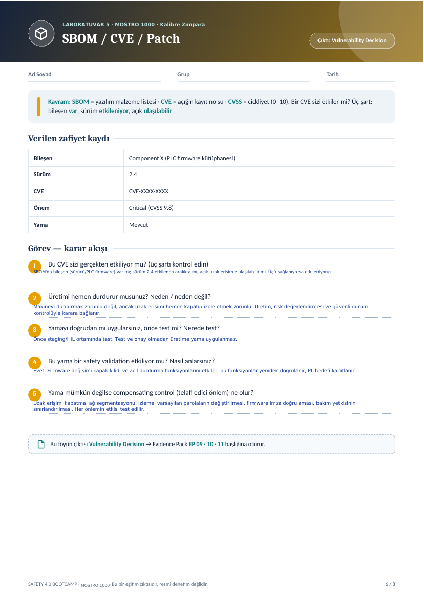
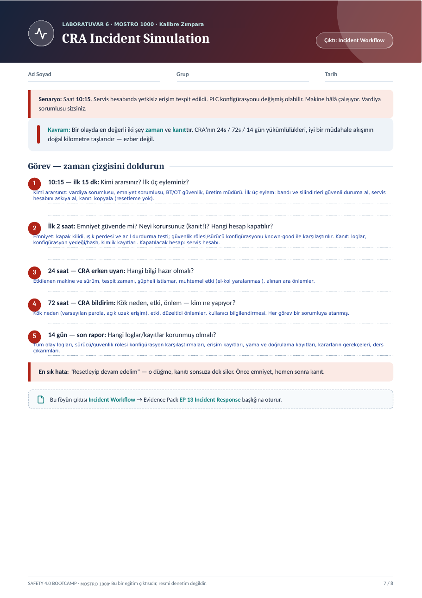
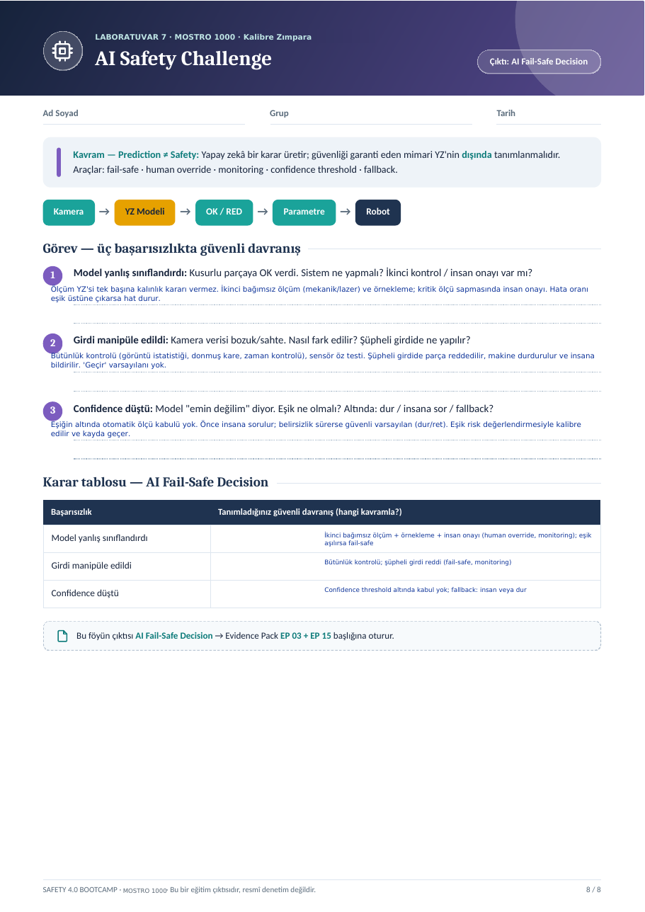

# MOSTRO 1000 Kalibre Zımpara Makinesi — Safety 4.0 Analizleri (Lab 1–7)

Safety 4.0 Bootcamp laboratuvar föylerinin **ilk yedi analizi**, örnek makine olarak
**MOSTRO 1000 kalibre zımpara makinesi** üzerinde doldurulmuştur.

> Bu föyler bir eğitim çıktısıdır; resmî denetim, uygunluk değerlendirmesi veya
> belgelendirme değildir ve CE/mevzuat uygunluğu garantisi vermez.

## Dosyalar

| Lab | Konu | Çıktı | Evidence Pack | PDF |
|---|---|---|---|---|
| 1 | Safety Architecture | Safety Function Map | EP 03 Safety Functions | [Lab1_Safety_Architecture.pdf](analizler/Lab1_Safety_Architecture.pdf) |
| 2 | IEC 62443 Mini Workshop | Zone / Conduit Diagram | EP 05 Zone & Conduit | [Lab2_IEC62443_Zone_Conduit.pdf](analizler/Lab2_IEC62443_Zone_Conduit.pdf) |
| 3 | Threat & Risk + Risk Matrix | Risk Register | EP 04 Risk Assessment | [Lab3_Threat_Risk_Matrix.pdf](analizler/Lab3_Threat_Risk_Matrix.pdf) |
| 4 | Secure Remote Access | Secure Architecture | EP 02 + EP 06 | [Lab4_Secure_Remote_Access.pdf](analizler/Lab4_Secure_Remote_Access.pdf) |
| 5 | SBOM / CVE / Patch | Vulnerability Decision | EP 09 · 10 · 11 | [Lab5_SBOM_CVE_Patch.pdf](analizler/Lab5_SBOM_CVE_Patch.pdf) |
| 6 | CRA Incident Simulation | Incident Workflow | EP 13 Incident Response | [Lab6_CRA_Incident_Simulation.pdf](analizler/Lab6_CRA_Incident_Simulation.pdf) |
| 7 | AI Safety Challenge | AI Fail-Safe Decision | EP 03 + EP 15 | [Lab7_AI_Safety_Challenge.pdf](analizler/Lab7_AI_Safety_Challenge.pdf) |

Lab 1–5 ve kapak tek dosyada: [MOSTRO1000_Lab1-5_Analizler.pdf](MOSTRO1000_Lab1-5_Analizler.pdf)
Sayfa görselleri: [`gorseller/`](gorseller/)

---

## Lab 1 · Safety Architecture

1. **Bu makinede tehlike nedir? İnsan neyden zarar görür?**
   Sıcak çene yanığı/ezilme, bant ve silindir çekilmesi, besleme sıkışması, bant kopması fırlaması, toz (solunum) ve yangın. Koruma açıkken parmak bant/silindire girer.
2. **Safety function hangisidir?**
   Koruyucu kapak açıldığında veya ışık perdesi ihlal edildiğinde tehlikeli hareketin (bant, besleme silindirleri) güvenli durdurulması (STO), acil durdurma dahil.
3. **Safety-related control system nerede?**
   Güvenlik rölesi/Safety PLC; kapak kilitli güvenlik anahtarları, ışık perdesi, acil durdurma → STO (sürücü) veya kontaktör. Şemada SAFETY YOLU kutularıdır.
4. **Normal PLC ile Safety PLC farkı nedir?**
   Normal PLC üretimi (hız, ölçü, besleme) yönetir. Safety PLC/güvenlik rölesi koruyucu fonksiyonu çift kanallı, kendini teşhis eden, sertifikalı yapıda yürütür.
5. **PLr / SIL neden var?**
   PLr → PL: çekilme riski yüksek olduğu için bant/silindir koruması PL d/e hedefler. Risk grafiği ile belirlenir ve kayda geçer.
6. **Safe state nedir?**
   Bant ve silindirlerin durduğu, enerjinin güvenli kesildiği, yeniden başlatma kilidinin devrede olduğu durum.
7. **Dijital bağımlılıklar?**
   Sürücü parametreleri (hız/akım sınırı), güvenlik rölesi konfigürasyonu, HMI ayarları, güncelleme kanalı, varsa uzak izleme modülü.
8. **Siber müdahale hangi noktadan bozar?**
   Uzaktan izleme/parametre yazma kanalı ve servis hesabı. Parametre değişirse kapak kilidi veya kalınlık sınırı bypass edilebilir.

## Lab 2 · IEC 62443 Mini Workshop

**Görev A**

1. **Bölgeler:** Zone 1 Güvenlik (güvenlik rölesi/Safety PLC, kapak kilitleri, ışık perdesi, acil durdurma); Zone 2 Kontrol (PLC, HMI, sürücüler); Zone 3 DMZ (uzak servis); Zone 4 Kurumsal. 'admin/admin' ve kilitsiz USB kabul edilemez.
2. **Safety PLC / uzak servis yerleşimi:** Uzak servis modülü Zone 3'e (DMZ) alınmalı. Zone 1 ve Zone 2'ye doğrudan bağlanmamalı. Bugünkü internete açık yerleşim kabul edilemez.
3. **Conduit'ler:** Zone 3→2: jump server, MFA, sınırlı protokol. Zone 2→1: yalnızca okuma veya veri diyotu, yazma yolu yok. Her geçişte kimlik, protokol filtresi, kayıt ve varsayılan kapalı.

**Görev B — uzak erişim kararı**

| Karar | Seçim + neden |
|---|---|
| Aracı | Jump server: tek ve izlenebilir giriş |
| Tünel | Sertifika tabanlı VPN, yalnızca gerekli adresler |
| Kimlik | MFA: parola tek başına yetersiz |
| Hesap | Kişisel hesap: sorumluluk ve iz için |
| Kayıt | Tam oturum kaydı: olay anında kanıt |
| Zamanlama | Varsayılan kapalı: yalnızca onaylı bakım penceresi |

## Lab 3 · Threat & Risk + Risk Matrix

| # | Senaryo (kim → kapı → zincir → fiziksel sonuç) | L | S | E | Skor | Öncelik |
|---|---|---|---|---|---|---|
| 1 | Uzak servis + admin/admin → sürücü/güvenlik parametresi değişimi → kapak kilidi bypass → el çekilmesi | 3 | 3 | 2 | 18 | Kritik |
| 2 | HMI'den yanlış kalınlık/besleme ayarı → parça geri tepmesi → besleme sıkışması, ezilme | 2 | 2 | 3 | 12 | Yüksek |
| 3 | Toz emme interlock'u devre dışı → toz birikimi → yangın / solunum | 1 | 2 | 3 | 6 | Orta |

1. **En yüksek öncelik:** Senaryo 1 (L3·S3·E2 = 18, Kritik). Parametre bypass'ı ile çekilme riski doğrudan operatöre yansır, sonuç geri alınamaz.
2. **S=3 olup skoru düşük kalan:** Senaryo 3: S=3 (yangın/solunum) ama olasılık düşük olduğundan skor 6 (Orta) çıkar. Risk kaydında ayrı satır olarak izlenmeli, emme interlock'u izlenir.

## Lab 4 · Secure Remote Access

**Görev A**

- **Mevcut:** Uzak servis modülü internete doğrudan açık; admin/admin; HMI aynı ağda; paylaşılan hesap; kayıt yok; sürekli açık.
- **Hedef:** 1) Jump server 2) MFA + sertifikalı VPN 3) Kişisel hesap, en az yetki, güvenlik parametresi ayrı onay 4) Tam kayıt 5) Varsayılan kapalı

**Görev B — functional safety köprüsü**

1. **Saldırgan içeri girerse emniyet fonksiyonu etkilenir mi?** Mimari doğru değilse evet: saldırgan koruma parametrelerini değiştirir ve kapak kilidini bypass eder. Doğru tasarımda güvenlik fonksiyonu ağdan bağımsız, fiziksel anahtar/yetki ile korunur ve güvenli duruma geçer.
2. **Gereksinim:** Kapak kilidi, acil durdurma ve bant/besleme durdurma davranışı uzak servis ve kontrol ağından bağımsız olmalı. Güvenlik parametreleri fiziksel yetki ve ayrı doğrulama gerektirmelidir.

## Lab 5 · SBOM / CVE / Patch

**Verilen zafiyet kaydı:** Component X (PLC firmware kütüphanesi) · sürüm 2.4 · CVE-XXXX-XXXX · Critical (CVSS 9.8) · yama mevcut.

1. **Bu CVE sizi gerçekten etkiliyor mu?** SBOM'da bileşen (sürücü/PLC firmware) var mı; sürüm 2.4 etkilenen aralıkta mı; açık uzak erişimle ulaşılabilir mi. Üçü sağlanıyorsa etkileniyoruz.
2. **Üretimi hemen durdurur musunuz?** Makineyi durdurmak zorunlu değil; ancak uzak erişimi hemen kapatıp izole etmek zorunlu. Üretim, risk değerlendirmesi ve güvenli durum kontrolüyle karara bağlanır.
3. **Yamayı doğrudan mı uygularsınız, önce test mi?** Önce staging/HIL ortamında test. Test ve onay olmadan üretime yama uygulanmaz.
4. **Bu yama bir safety validation etkiliyor mu?** Evet. Firmware değişimi kapak kilidi ve acil durdurma fonksiyonlarını etkiler; bu fonksiyonlar yeniden doğrulanır, PL hedefi kanıtlanır.
5. **Yama mümkün değilse compensating control?** Uzak erişimi kapatma, ağ segmentasyonu, izleme, varsayılan parolaların değiştirilmesi, firmware imza doğrulaması, bakım yetkisinin sınırlandırılması. Her önlemin etkisi test edilir.

## Lab 6 · CRA Incident Simulation

**Senaryo:** Saat 10:15. Servis hesabında yetkisiz erişim tespit edildi. PLC konfigürasyonu değişmiş olabilir. Makine hâlâ çalışıyor. Vardiya sorumlusu sizsiniz.

**Görev — zaman çizgisi**

1. **10:15 — ilk 15 dk:** Kimi ararsınız? Vardiya sorumlusu, emniyet sorumlusu, BT/OT güvenlik ve üretim müdürü. İlk üç eylem: bandı ve silindirleri güvenli duruma alın, servis hesabını askıya alın, kanıtı kopyalayın (resetleme yok).
2. **İlk 2 saat:** Emniyet: kapak kilidi, ışık perdesi ve acil durdurma testi; güvenlik rölesi/sürücü konfigürasyonu known-good ile karşılaştırılır. Kanıt: loglar, konfigürasyon yedeği/hash, kimlik kayıtları. Kapatılacak hesap: servis hesabı.
3. **24 saat — CRA erken uyarı:** Etkilenen makine ve sürüm, tespit zamanı, şüpheli istismar, muhtemel etki (el-kol yaralanması), alınan ara önlemler.
4. **72 saat — CRA bildirim:** Kök neden (varsayılan parola, açık uzak erişim), etki, düzeltici önlemler, kullanıcı bilgilendirmesi. Her görev bir sorumluya atanır.
5. **14 gün — son rapor:** Tüm olay logları, sürücü/güvenlik rölesi konfigürasyon karşılaştırmaları, erişim kayıtları, yama ve doğrulama kayıtları, kararların gerekçeleri, ders çıkarımları.

**En sık hata:** "Resetleyip devam edelim." Bu, kanıtı sonsuza dek siler. Önce emniyet, hemen sonra kanıt.

## Lab 7 · AI Safety Challenge

**Kavram — Prediction ≠ Safety:** Yapay zekâ bir karar üretir; güvenliği garanti eden mimari YZ'nin dışında tanımlanmalıdır. Araçlar: fail-safe, human override, monitoring, confidence threshold, fallback.

Akış: Kamera → YZ Modeli → OK / RED → Parametre → Robot

**Görev — üç başarısızlıkta güvenli davranış**

1. **Model yanlış sınıflandırdı (kusurlu parçaya OK verdi):** YZ tek başına kalınlık kararı vermez. İkinci bağımsız ölçüm (mekanik/lazer) ve örnekleme yapılır; kritik ölçü sapmasında insan onayı alınır. Hata oranı eşik üstüne çıkarsa hat durur.
2. **Girdi manipüle edildi (kamera verisi bozuk/sahte):** Bütünlük kontrolü (görüntü istatistiği, donmuş kare, zaman kontrolü) ve sensör öz testi yapılır. Şüpheli girdide parça reddedilir, makine durdurulur ve insana bildirilir. "Geçir" varsayılanı yoktur.
3. **Confidence düştü ("emin değilim"):** Eşiğin altında otomatik ölçü kabulü yoktur. Önce insana sorulur; belirsizlik sürerse güvenli varsayılan (dur/ret) uygulanır. Eşik risk değerlendirmesiyle kalibre edilir ve kayda geçer.

**Karar tablosu — AI Fail-Safe Decision**

| Başarısızlık | Tanımlanan güvenli davranış (kavram) |
|---|---|
| Model yanlış sınıflandırdı | İkinci bağımsız ölçüm + örnekleme + insan onayı (human override, monitoring); eşik aşılırsa fail-safe |
| Girdi manipüle edildi | Bütünlük kontrolü; şüpheli girdi reddi (fail-safe, monitoring) |
| Confidence düştü | Threshold altında kabul yok; fallback: insan veya dur |

## Ek · SWOT Analizi

Makinenin kapsamlı SWOT analizi (pazar, rakip ve CE/uyum tehditleriyle birlikte): [SWOT_Analizi_MOSTRO1000.md](analizler/SWOT_Analizi_MOSTRO1000.md)

Öne çıkan bulgular:
- **Güçlü yön:** 1000 mm genişlik ve 160 mm kalınlık kapasitesi, 28,97 kW güç.
- **Zayıf yön:** İlanda CE işareti, uygunluk beyanı ve üretici bilgisi yok.
- **Fırsat:** 20 Ocak 2027'de yürürlüğe girecek AB Makine Yönetmeliği için erken uyum.
- **Tehdit:** Sektör ihracatı 2022'den 2025'e kadar yaklaşık 150 milyon dolarda durağan kaldı.
