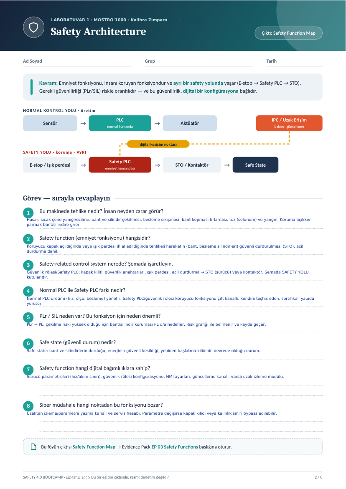
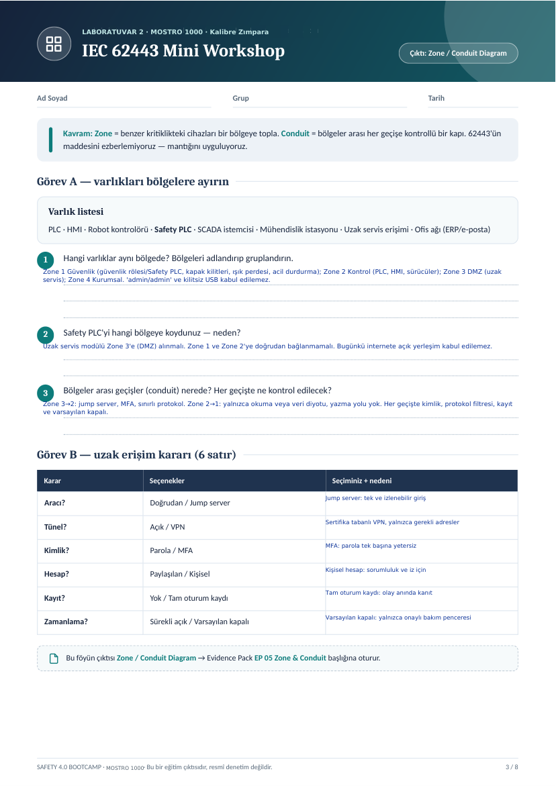
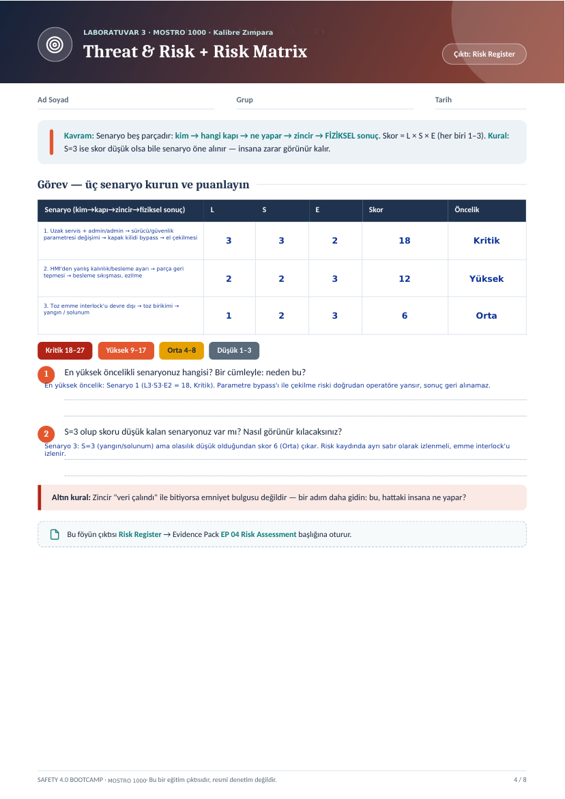
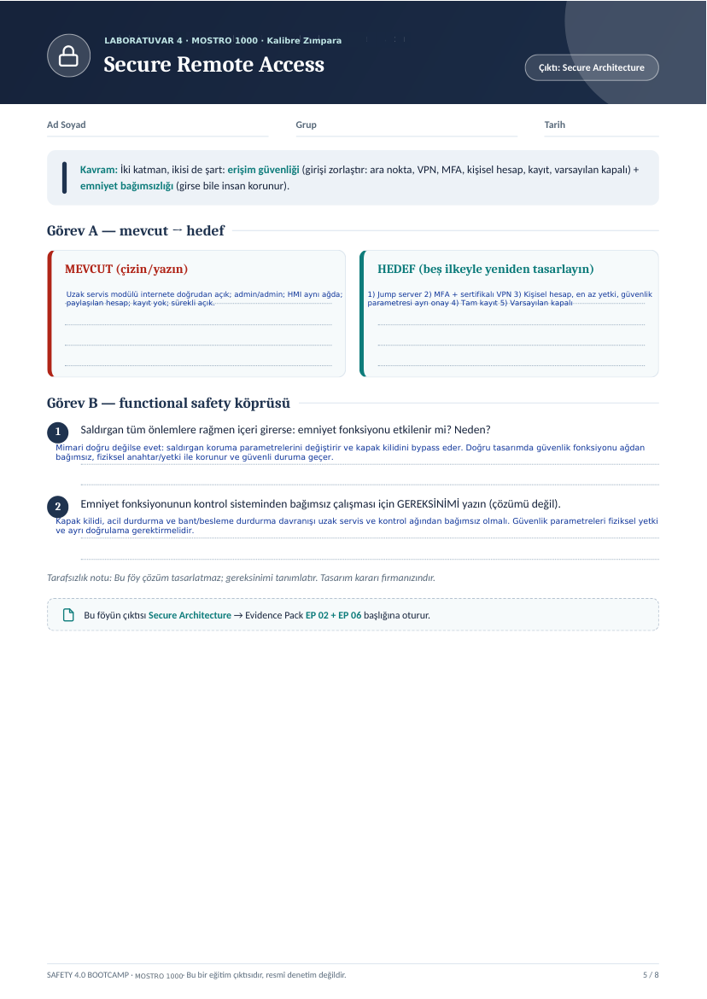

# MOSTRO 1000 Kalibre Zımpara Makinesi — Safety 4.0 Analizleri (Lab 1–4)

Safety 4.0 Bootcamp laboratuvar föylerinin **ilk dört analizi**, örnek makine olarak
**MOSTRO 1000 kalibre zımpara makinesi** üzerinde doldurulmuştur.

> Bu föyler bir eğitim çıktısıdır; resmî denetim, uygunluk değerlendirmesi veya
> belgelendirme değildir ve CE/mevzuat uygunluğu garantisi vermez.

## Dosyalar

| Lab | Konu | Çıktı | Evidence Pack | PDF |
|---|---|---|---|---|
| 1 | Safety Architecture | Safety Function Map | EP 03 Safety Functions | [Lab1_Safety_Architecture.pdf](analizler/Lab1_Safety_Architecture.pdf) |
| 2 | IEC 62443 Mini Workshop | Zone / Conduit Diagram | EP 05 Zone & Conduit | [Lab2_IEC62443_Zone_Conduit.pdf](analizler/Lab2_IEC62443_Zone_Conduit.pdf) |
| 3 | Threat & Risk + Risk Matrix | Risk Register | EP 04 Risk Assessment | [Lab3_Threat_Risk_Matrix.pdf](analizler/Lab3_Threat_Risk_Matrix.pdf) |
| 4 | Secure Remote Access | Secure Architecture | EP 02 + EP 06 | [Lab4_Secure_Remote_Access.pdf](analizler/Lab4_Secure_Remote_Access.pdf) |

Dört lab ve kapak tek dosyada: [MOSTRO1000_Lab1-4_Analizler.pdf](MOSTRO1000_Lab1-4_Analizler.pdf)
Sayfa görselleri: [`gorseller/`](gorseller/)

---

## Lab 1 · Safety Architecture

1. **Bu makinede tehlike nedir? İnsan neyden zarar görür?**
   Sıcak çene yanığı/ezilme, bant ve silindir çekilmesi, besleme sıkışması, bant kopması fırlaması, toz (solunum) ve yangın. Koruma açıkken parmak bant/silindire girer.
2. **Safety function hangisidir?**
   Koruyucu kapak açıldığında veya ışık perdesi ihlal edildiğinde tehlikeli hareketin (bant, besleme silindirleri) güvenli durdurulması (STO), acil durdurma dahil.
3. **Safety-related control system nerede?**
   Güvenlik rölesi/Safety PLC; kapak kilitli güvenlik anahtarları, ışık perdesi, acil durdurma → STO (sürücü) veya kontaktör. Şemada SAFETY YOLU kutularıdır.
4. **Normal PLC ile Safety PLC farkı nedir?**
   Normal PLC üretimi (hız, ölçü, besleme) yönetir. Safety PLC/güvenlik rölesi koruyucu fonksiyonu çift kanallı, kendini teşhis eden, sertifikalı yapıda yürütür.
5. **PLr / SIL neden var?**
   PLr → PL: çekilme riski yüksek olduğu için bant/silindir koruması PL d/e hedefler. Risk grafiği ile belirlenir ve kayda geçer.
6. **Safe state nedir?**
   Bant ve silindirlerin durduğu, enerjinin güvenli kesildiği, yeniden başlatma kilidinin devrede olduğu durum.
7. **Dijital bağımlılıklar?**
   Sürücü parametreleri (hız/akım sınırı), güvenlik rölesi konfigürasyonu, HMI ayarları, güncelleme kanalı, varsa uzak izleme modülü.
8. **Siber müdahale hangi noktadan bozar?**
   Uzaktan izleme/parametre yazma kanalı ve servis hesabı. Parametre değişirse kapak kilidi veya kalınlık sınırı bypass edilebilir.

## Lab 2 · IEC 62443 Mini Workshop

**Görev A**

1. **Bölgeler:** Zone 1 Güvenlik (güvenlik rölesi/Safety PLC, kapak kilitleri, ışık perdesi, acil durdurma); Zone 2 Kontrol (PLC, HMI, sürücüler); Zone 3 DMZ (uzak servis); Zone 4 Kurumsal. 'admin/admin' ve kilitsiz USB kabul edilemez.
2. **Safety PLC / uzak servis yerleşimi:** Uzak servis modülü Zone 3'e (DMZ) alınmalı. Zone 1 ve Zone 2'ye doğrudan bağlanmamalı. Bugünkü internete açık yerleşim kabul edilemez.
3. **Conduit'ler:** Zone 3→2: jump server, MFA, sınırlı protokol. Zone 2→1: yalnızca okuma veya veri diyotu, yazma yolu yok. Her geçişte kimlik, protokol filtresi, kayıt ve varsayılan kapalı.

**Görev B — uzak erişim kararı**

| Karar | Seçim + neden |
|---|---|
| Aracı | Jump server: tek ve izlenebilir giriş |
| Tünel | Sertifika tabanlı VPN, yalnızca gerekli adresler |
| Kimlik | MFA: parola tek başına yetersiz |
| Hesap | Kişisel hesap: sorumluluk ve iz için |
| Kayıt | Tam oturum kaydı: olay anında kanıt |
| Zamanlama | Varsayılan kapalı: yalnızca onaylı bakım penceresi |

## Lab 3 · Threat & Risk + Risk Matrix

| # | Senaryo (kim → kapı → zincir → fiziksel sonuç) | L | S | E | Skor | Öncelik |
|---|---|---|---|---|---|---|
| 1 | Uzak servis + admin/admin → sürücü/güvenlik parametresi değişimi → kapak kilidi bypass → el çekilmesi | 3 | 3 | 2 | 18 | Kritik |
| 2 | HMI'den yanlış kalınlık/besleme ayarı → parça geri tepmesi → besleme sıkışması, ezilme | 2 | 2 | 3 | 12 | Yüksek |
| 3 | Toz emme interlock'u devre dışı → toz birikimi → yangın / solunum | 1 | 2 | 3 | 6 | Orta |

1. **En yüksek öncelik:** Senaryo 1 (L3·S3·E2 = 18, Kritik). Parametre bypass'ı ile çekilme riski doğrudan operatöre yansır, sonuç geri alınamaz.
2. **S=3 olup skoru düşük kalan:** Senaryo 3: S=3 (yangın/solunum) ama olasılık düşük olduğundan skor 6 (Orta) çıkar. Risk kaydında ayrı satır olarak izlenmeli, emme interlock'u izlenir.

## Lab 4 · Secure Remote Access

**Görev A**

- **Mevcut:** Uzak servis modülü internete doğrudan açık; admin/admin; HMI aynı ağda; paylaşılan hesap; kayıt yok; sürekli açık.
- **Hedef:** 1) Jump server 2) MFA + sertifikalı VPN 3) Kişisel hesap, en az yetki, güvenlik parametresi ayrı onay 4) Tam kayıt 5) Varsayılan kapalı

**Görev B — functional safety köprüsü**

1. **Saldırgan içeri girerse emniyet fonksiyonu etkilenir mi?** Mimari doğru değilse evet: saldırgan koruma parametrelerini değiştirir ve kapak kilidini bypass eder. Doğru tasarımda güvenlik fonksiyonu ağdan bağımsız, fiziksel anahtar/yetki ile korunur ve güvenli duruma geçer.
2. **Gereksinim:** Kapak kilidi, acil durdurma ve bant/besleme durdurma davranışı uzak servis ve kontrol ağından bağımsız olmalı. Güvenlik parametreleri fiziksel yetki ve ayrı doğrulama gerektirmelidir.
